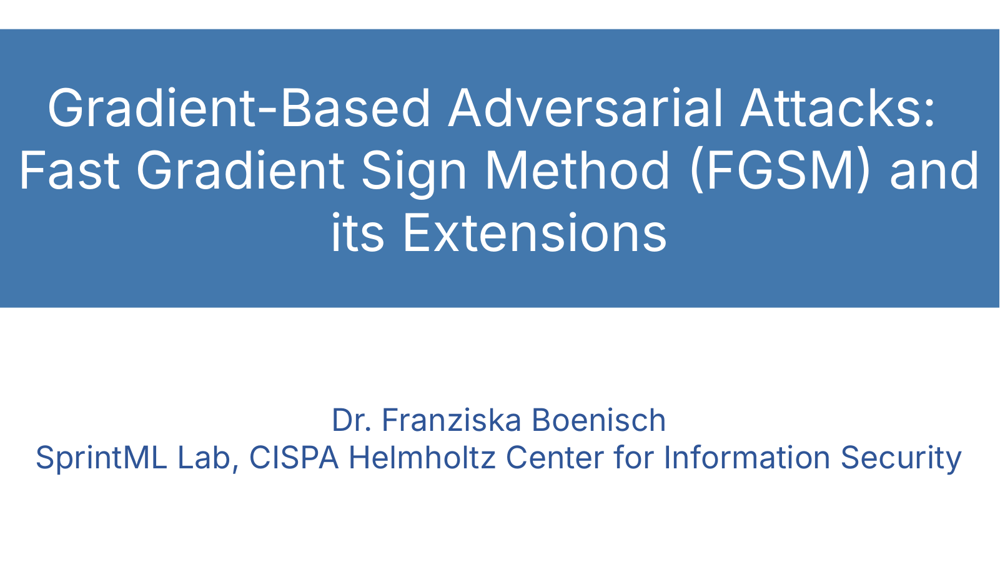

This page provides study materials on **adversarial examples**: inputs with small, carefully crafted perturbations that fool machine learning models, such as a panda image that a model confidently classifies as a gibbon. The lecture shows how the gradients used to train a model can be turned around to *learn* adversarial noise, introduces the **Fast Gradient Sign Method (FGSM)** and the intuition for why the sign of the gradient suffices, and extends it to the iterative attacks **BIM** and **PGD**. It closes with **adversarial training** as a defense.

## Watch the Lecture

<iframe style="position: absolute; top: 0; left: 0; width: 100%; height: 100%;" src="https://www.youtube.com/embed/9C5EmAVkgAg" title="Gradient-Based Adversarial Attacks: FGSM and its Extensions" frameborder="0" allow="accelerometer; autoplay; clipboard-write; encrypted-media; gyroscope; picture-in-picture; web-share" referrerpolicy="strict-origin-when-cross-origin" allowfullscreen></iframe>

---

## Download the Lecture Slides

📄 Click the image to download the slides (PDF).

---

## Listen to the Podcast

Using the lecture notes, I made an AI-generated podcast with NotebookLM for auditory learners.

<audio controls>
  <source src="/static/assets/teaching/2026-adversarial-examples/fgsm-podcast.mp3" type="audio/mpeg">
  Your browser does not support the audio element.
</audio>

---

## Find Additional Study Materials

### Papers Covered in the Lecture
- Introduction of adversarial examples: [Intriguing properties of neural networks](https://arxiv.org/abs/1312.6199)
- FGSM: [Explaining and harnessing adversarial examples](https://arxiv.org/abs/1412.6572)
- BIM: [Adversarial examples in the physical world](https://arxiv.org/abs/1607.02533)
- PGD: [Towards Deep Learning Models Resistant to Adversarial Attacks](https://arxiv.org/abs/1706.06083)

### Other Learning Materials
- [Lecture by Ian Goodfellow](https://www.youtube.com/watch?v=CIfsB_EYsVI&t=4251s), one of the pioneers of adversarial attacks
- Code of common attacks in [Foolbox](https://github.com/bethgelab/foolbox); the gradient-based attacks from the lecture build on [this base class](https://github.com/bethgelab/foolbox/blob/master/foolbox/attacks/gradient_descent_base.py#L156)

### Going Further
- [Practical Black-Box Attacks against Machine Learning](https://arxiv.org/abs/1602.02697): the first paper to show how to craft adversarial examples with only black-box access
- [Robust Physical-World Attacks on Deep Learning Visual Classification](https://openaccess.thecvf.com/content_cvpr_2018/papers/Eykholt_Robust_Physical-World_Attacks_CVPR_2018_paper.pdf): robust physical-world adversarial examples, e.g. stickers on stop signs that get them misclassified
- [Synthesizing Robust Adversarial Examples](https://arxiv.org/abs/1707.07397): the first physical adversarial objects, e.g. a 3D-printed turtle that is classified as a rifle
- ["Real Attackers Don't Compute Gradients": Bridging the Gap Between Adversarial ML Research and Practice](https://arxiv.org/abs/2212.14315): connects new attacks in research with practice, i.e., developers and the systems in which models are embedded

<a href="/#teaching">&larr; All teaching samples</a>

