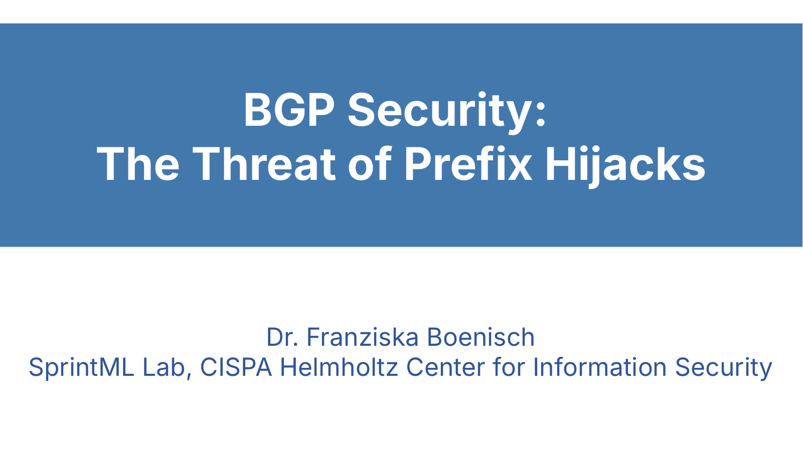

This page provides study materials on the **Border Gateway Protocol (BGP)**, the protocol that holds the internet together. Starting from the 2008 incident in which YouTube went offline worldwide for hours, the lecture explains how autonomous systems announce routes, why BGP operates on trust, and how **prefix hijacks** exploit that trust. It then covers defenses, from prefix filters and monitoring to **RPKI** (origin validation) and **BGPsec** (path validation), and discusses why their adoption is still slow.

## Watch the Lecture

<iframe style="position: absolute; top: 0; left: 0; width: 100%; height: 100%;" src="https://www.youtube.com/embed/dosA5USAl38" title="BGP Security: The Threat of Prefix Hijacks" frameborder="0" allow="accelerometer; autoplay; clipboard-write; encrypted-media; gyroscope; picture-in-picture; web-share" referrerpolicy="strict-origin-when-cross-origin" allowfullscreen></iframe>

---

## Download the Lecture Slides

📄 Click the image to download the slides (PDF).

---

## Listen to the Podcast

Using the lecture notes, I made an AI-generated podcast with NotebookLM for auditory learners.

<audio controls>
  <source src="/static/assets/teaching/2026-bgp/bgp-podcast.mp3" type="audio/mpeg">
  Your browser does not support the audio element.
</audio>

---

## Find Additional Study Materials

### What is BGP?
- Short [video](https://youtu.be/SVo6cDnQQm0) on what BGP is
- Formal introduction to BGP in the textbook [Computer Networking: A Top-Down Approach](https://gaia.cs.umass.edu/kurose_ross/index.php) by Kurose and Ross, Chapter 5 (also covers routing preferences)

### What are BGP Hijacks?
- [Overview of BGP hijacking](https://bishopfox.com/blog/bgp-hijacking-overview)

### More Insight into the YouTube Incident
- The Pakistani incident [explained in detail](https://web.mit.edu/6.02/www/s2012/handouts/youtube-pt.pdf)
- Newspaper article on the incident: [Pakistan Cuts Access to YouTube Worldwide](https://www.nytimes.com/2008/02/26/technology/26tube.html) (New York Times)
- [RIPE NCC study](https://web.archive.org/web/20080405030750/http://www.ripe.net/news/study-youtube-hijacking.html) of the incident

### Defenses
- [RPKI documentation](https://rpki.readthedocs.io/en/latest/rpki/securing-bgp.html)
- [BGPsec specification](https://datatracker.ietf.org/doc/html/rfc8205) (RFC 8205)
- [RPKI: Not Perfect But Good Enough](https://arxiv.org/abs/2409.14518) (also a good detailed background)

### Going Further
- [SoK: An Introspective Analysis of RPKI Security](https://arxiv.org/abs/2408.12359): the inner workings of RPKI, its certificate chains, and attack vectors

<a href="/#teaching">&larr; All teaching samples</a>

