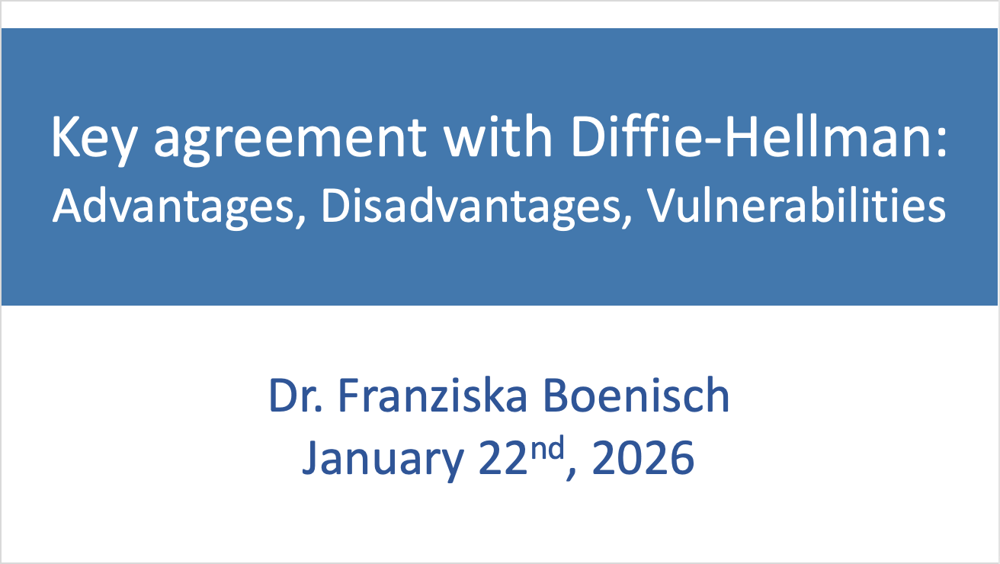

This page provides study materials on the Diffie-Hellman protocol for **secure key exchange** over **insecure channels**. The corresponding lecture introduces the intuition on why we need key exchange, explains the protocol and why it is secure, discusses vulnerabilities and how to fix them, and finally goes through advantages and disadvantages.

## (Re-)Watch the Lecture

  <iframe width="560" height="315" src="https://www.youtube.com/embed/6gcl-bInH-w?si=eZNmeAjIrGXx3e1-" title="YouTube video player" frameborder="0" allow="accelerometer; autoplay; clipboard-write; encrypted-media; gyroscope; picture-in-picture; web-share" referrerpolicy="strict-origin-when-cross-origin" allowfullscreen></iframe>

---

## Download the Lecture Slides

📄 Please click the image to download/view the slides (PDF).

---

## Listen to the Podcast

Using the lecture notes, I made an AI-generated podcast with NotebookLM for auditory learners. 

<audio controls>
  <source src="/static/assets/teaching/2026-01-diffie-hellman/dh-podcast.mp3" type="audio/mpeg">
  Your browser does not support the audio element.
</audio>

---

## Find Additional Study Materials

1. Great lectures from RUB about [Diffie-Hellman](https://youtu.be/aeOzBCbwxUo?si=mG6BvSMQX9e1-zlK) 
2. Full introduction book on ["Understanding Cryptography"](https://www.cryptography-textbook.com) by Christof Paar, Jan Pelzl, Bart Preneel
3. Full introduction book on ["IT-Sicherheit: Konzepte - Verfahren - Protokolle"](https://www.degruyterbrill.com/document/doi/10.1515/9783110985115/html?lang=en&srsltid=AfmBOoqp8ln4cKTcIQ_okQ8JaJ3UwksLk3pML14LX1Eg1TV_9Gd9eOjk) by Claudia Eckert 
4. Small [Intro Video](https://www.youtube.com/watch?v=KXq065YrpiU) on Diffie-Hellman
5. [Shor's Algorithm:](https://www.youtube.com/watch?v=lvTqbM5Dq4Q&t=881s) How Quantum Computers affect Diffie-Hellman

<a href="/#teaching">&larr; All teaching samples</a>

